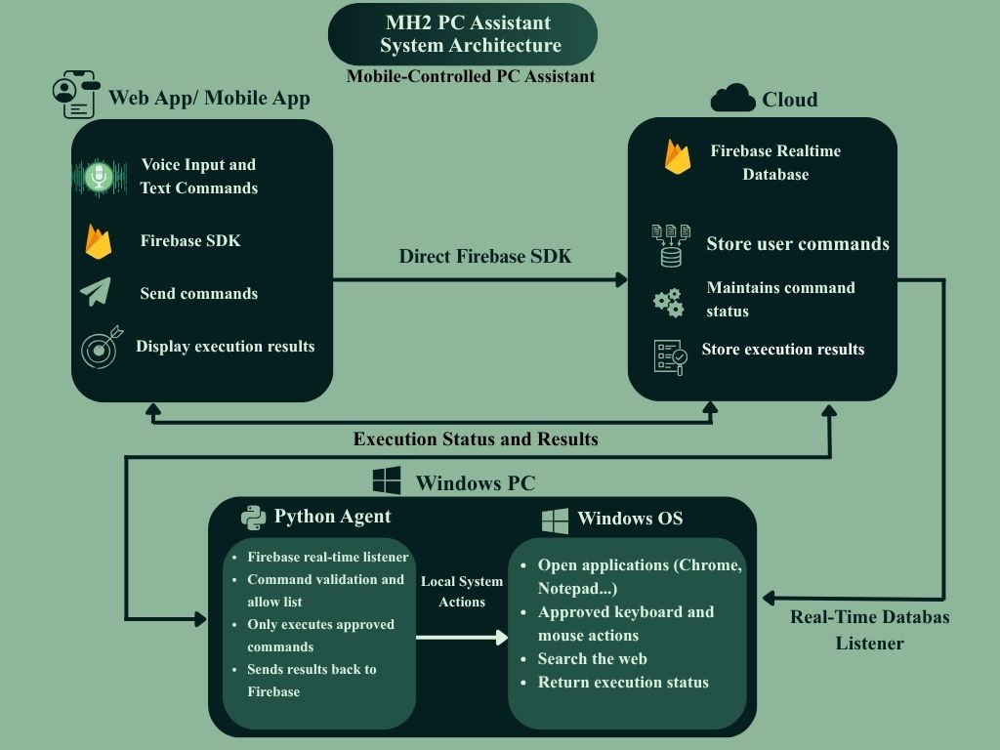

#  MH2 PC Assistant

> 🚧 **UNDER CONSTRUCTION — This project is currently in development.**
>
> MH2 PC Assistant is being built. Features, setup instructions, and project details may change as development continues.

**Control your Windows PC from your phone using voice or text commands.**

MH2 PC Assistant is a personal remote PC control project designed to make computer tasks easier. Use your phone to send commands and let your Windows PC perform supported actions through a Python agent.

The project uses Firebase to connect the phone and PC, with a simple web app for sending commands and receiving responses.

##  Planned Features

-  **Phone Control** — Control your PC from a mobile-friendly web app.
-  **Voice Commands** — Speak commands using your phone.
-  **Text Commands** — Type commands and send them to your PC.
-  **App Launcher** — Open apps such as Chrome, Notepad, and VS Code.
-  **Web Search** — Search the web using simple commands.
-  **Smart Replies** — Receive command results on your phone.
-  **Keyboard Control** — Type text and use supported keyboard shortcuts.
-  **Mouse Control** — Add remote mouse actions.
-  **PC Status** — Check whether your PC agent is online.
-  **File Transfer** — Planned support for transferring files.
-  **Remote Screen** — Planned screen viewing and remote interaction.

*These features are planned; availability depends on development progress.*

---
## System Architecture



---
##  How It Works

```text
 Phone
   │
   ▼
 MH2 Web App
   │
   ▼
 Firebase
   │
   ▼
 Python Agent
   │
   ▼
 Windows PC
   │
   ▼
 Result sent back to phone
```

The phone sends a command through the web app. Firebase passes the request to the Python agent running on the Windows PC. The agent performs an approved action and returns the result.

##  Technologies

| Technology | Purpose |
|---|---|
| HTML5 | Web app structure |
| CSS3 | Responsive design |
| JavaScript | App functionality |
| Firebase Realtime Database | Phone-to-PC communication |
| Firebase Authentication | User authentication |
| Firebase Hosting | Web app deployment |
| Python | Windows PC automation |
| PyAutoGUI | Keyboard and mouse control |
| Web Speech API | Voice input support |

##  Target Platform

- **Controller:** Android phone or mobile browser
- **Computer:** Windows PC
- **Communication:** Internet + Firebase
- **PC Agent:** Python
- **Interface:** HTML, CSS, and JavaScript

##  Development Status

- [x] Project idea and name
- [x] Initial system design
- [ ] Mobile-friendly web interface
- [ ] Firebase connection
- [ ] Python PC agent
- [ ] Voice and text commands
- [ ] Application control
- [ ] Command replies and PC status
- [ ] Security testing
- [ ] Optional file transfer and remote screen

The checklist will be updated as development progresses.

##  Security

Security is an important part of this project.

- Require authentication for remote access.
- Validate commands before executing them.
- Allow only supported PC actions.
- Never execute unrestricted commands received from the database.
- Keep private credentials out of the repository.
- Require confirmation for sensitive actions.

**Important:** Remote PC control should only be used on computers you own or have permission to control.

##  Current Notice

This repository is under active development. The complete setup guide and working release will be added as the project grows.

Please check back for updates.

## 👨‍💻 Developer

**MH2 HRIDOY**

Software Developer | Web & Mobile App Developer

- GitHub: [@mhhridoy7907](https://github.com/mhhridoy7907)
- Portfolio: [mh2-hridoy.web.app](https://mh2-hridoy.web.app)

---

⭐ **Follow the project to see its progress!**

*Built with ❤️ by MH2 HRIDOY.*
