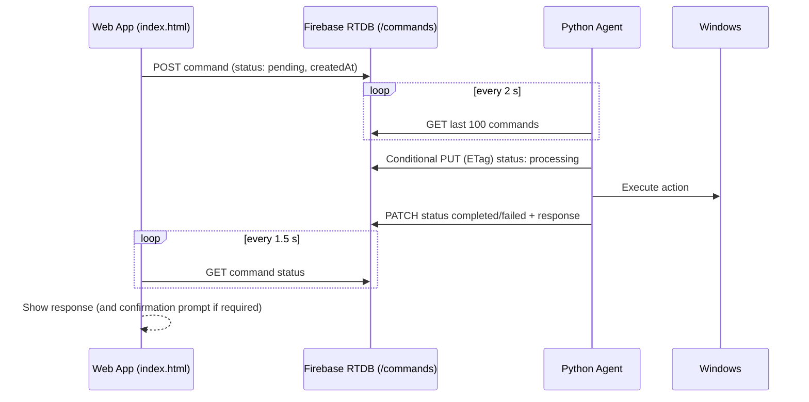

# MH2 PC Assistant — Control a Windows PC from a Phone

A case study in remote desktop automation, command-queue design, and honest engineering.

| | |
|---|---|
| **Project type** | Personal software engineering project |
| **Developer** | MH2 HRIDOY |
| **Status** | Under construction: functional prototype, not yet release-ready |
| **Technologies** | HTML, CSS, JavaScript, Firebase Realtime Database (REST), Python, Windows APIs |
| **Last reviewed** | 15 October 2026 (static source review of the web app and three agent iterations) |
| **Repository** | https://github.com/mhhridoy7907/MH2-PC-Assistant |

**How to read the status labels in this document**

| Label | Meaning |
|---|---|
| **Code-verified** | Implementation is present and internally consistent. Not proof of runtime success. |
| **Author-reported tested** | The author states it was tested. No logs or results were supplied for independent verification. |
| **Needs runtime testing** | Code exists; actual behavior has not been demonstrated. |
| **Partial** | Some functionality exists; important parts are missing. |
| **Not implemented** | Absent from the current source. |

---

## 1. Executive Summary

MH2 PC Assistant lets a user control a Windows PC from a phone. A mobile-friendly web app writes commands to Firebase Realtime Database; a Python agent on the PC polls the database, claims each command, executes it through Windows automation, and writes the status and response back for the web app to display.

The project's purpose is to understand the full path a command travels: user interface, cloud database, desktop agent, operating system, and back. Across three iterations of the Python agent, the system grew from a straightforward regex dispatcher into an agent with stale-command recovery, safe text entry, Chrome-aware browsing, WhatsApp contact automation with verification, confirmation-gated destructive actions, and sentence-level command scanning.

The current state is a capable prototype. The command surface is broad and the front end and agent share a consistent protocol for most commands. It is not release-ready: the command channel has no verified authentication, one confirmation behavior regressed in the latest agent, one command emitted by the web app is not understood by the newer agents, and runtime testing is limited to the author's own report.

---

## 2. Background, Motivation, and Problem Statement

The idea came from an interest in remote computer control and system architecture: how can an application receive a command on a phone and carry it out on a separate computer over the internet? Rather than building only a user interface, the project focuses on the communication flow among the web app, the database, the Python agent, and Windows.

**Main challenges**

- Establishing communication between a browser on one network and a PC on another.
- Reading, claiming, and processing commands exactly once.
- Translating spoken or typed phrases into recognizable actions.
- Executing Windows automation reliably and safely.
- Handling failed, delayed, duplicated, and expired commands.
- Protecting a system that can type into windows and press keys on a real computer.

---

## 3. Objectives and Scope

**Objectives**

1. Send commands from a phone-friendly web interface to a Windows PC through Firebase.
2. Execute a useful set of PC actions: applications, browsing, typing, mouse, windows, files, and system operations.
3. Return execution status and a readable response to the phone.
4. Understand reasonably flexible phrasing, including voice input.
5. Treat destructive actions with explicit confirmation.

**In scope:** the web app (`index.html`), the Python agent (three iterations), the Firebase command protocol, and documentation.

**Out of scope for the current state:** a dedicated backend server, a persistent WebSocket connection, a mobile touchpad interface, and multi-PC management. These appear as future work, not as existing features.

---

## 4. System Architecture and Command Flow

```
Phone / Web App  ->  Firebase Realtime Database  ->  Python Agent  ->  Windows PC
        ^                                                   |
        +------------ status + response <-------------------+
```



**Command record (written by the web app)**
`command`, `text`, `source` (`text` or `voice`), `status: "pending"`, `response: null`, `createdAt` (epoch ms), `client`, `protocolVersion`.

**Fields written by the agent**
`status` (`processing`, then `completed` or `failed`), `response`, `error`, `claimedAt`, `updatedAt`, `completedAt`, `agentId`, and the confirmation fields `requiresConfirmation`, `confirmPhrase`, `confirmationTimeout`.

**Lifecycle rules (code-verified)**

- The agent claims a command with a compare-and-set write using Firebase's ETag, so two agents cannot both run it.
- Commands older than 60 seconds are failed rather than executed.
- Commands left in `processing` by a crashed agent are marked failed after 120 seconds and are never re-run (agent2 and agent3).
- The web app gives up after 45 seconds; if the command is still `pending` it patches it to `expired`.

**Why polling:** polling over Firebase's REST API is simple to implement and debug. Its cost is latency. A persistent connection is a possible future improvement, not part of the current system.

---

## 5. Technology Stack and Actual Roles

| Technology | Role in the project |
|---|---|
| HTML, CSS, JavaScript | Single-file web app: chat UI, settings, voice session, polling client. No framework or build step. |
| Web Speech API (browser) | Voice command input and spoken responses in the web app. Requires a supporting browser (Chrome or Edge) and HTTPS. |
| Web Audio API | Ringing tone in the simulated call screen. |
| Firebase Realtime Database | Command queue and response store, accessed through its REST API. |
| Python | PC-side agent and command-processing logic. |
| `requests` | Firebase REST calls from the agent. |
| PyAutoGUI | Keyboard, mouse click, scrolling, screenshots, volume keys. |
| Pyperclip | Clipboard-based text entry (paste with clipboard restore). |
| `ctypes` / Windows APIs | Window enumeration and focus, cursor control, Recycle Bin, known folders, lock, drive listing. |
| `subprocess`, `os.startfile` | Launch applications, folders, and `shutdown.exe`. |
| `winreg` (agent2, agent3) | Locate Google Chrome. |
| `uiautomation` (optional, agent2, agent3) | Read UI elements to verify WhatsApp contacts and chats. |
| Regular expressions | Match command phrases, aliases, and arguments. |

`webbrowser` was used by agent1 only and was dropped in later versions.

---

## 6. Web Application Implementation

`index.html` is a self-contained, mobile-first application.

**Implemented (code-verified)**

- Chat-style interface with quick-command buttons, a multi-line composer (Enter to send), message status labels, history stored in the browser (last 100 messages), and chat export.
- Settings dialog for the Firebase Database URL and an optional ID token, with a connection test.
- Command submission and status polling consistent with the agent protocol, including `processing`, `completed`, `failed`, and `expired` handling.
- Output escaping for rendered messages.
- Voice session: speech recognition, spoken responses, mute, call timer, and a ringing tone.
- Voice-to-command mapping for files, drives, folders, Recycle Bin, apps, mouse actions, typing mode, and confirm/cancel phrases.
- Typing mode: dictated text is sent as typing commands until the user says "type end".
- Confirmation handling: when the agent requests confirmation, the app waits for the exact phrase, cancels on cancel phrases, and times out.
- Responsive layout, safe-area handling, focus styles, and reduced-motion support.

**Honest description of controls that are not what they might appear to be**

- The call screen is a **local simulation**, not a telephone call (the app states this on screen).
- The keypad displays digits only; DTMF is not implemented (the app says so).
- The speaker button stores a preference and cannot force audio routing.
- The record button records the browser microphone locally for download; it is unrelated to PC control.
- There is **no touchpad interface**; the mouse is controlled only through text or voice commands.
- The connection indicator reports configuration, not live agent availability.

**Needs attention:** the app sends `OPEN_FILE_MANAGER`, which agent2 and agent3 do not recognize (see Section 12).

---

## 7. Python Agent Architecture

The agent is a single Windows-only Python program organized into four layers.

1. **`FirebaseREST`:** HTTP session, command listing (`orderBy="$key"`, `limitToLast=100`), updates, and the ETag compare-and-set claim. Errors are normalized into an `AgentError`.
2. **`WindowsActions`:** the operations: launching and focusing windows, text entry, key presses, mouse, scrolling, folders and drives, browser and website control, WhatsApp, volume, screenshots, lock, and Recycle Bin.
3. **`PCCommandDispatcher`:** the parsing and routing pipeline plus the confirmation state machine.
4. **`MH2PCAssistantAgent`:** the polling loop, deduplication, expiry, claiming, execution, and response writing, with back-off on failures.

**Command parsing pipeline (agent3)**

1. Normalize and clean the text: strip fillers such as "please", "hey", and "can you"; correct common speech-to-text errors in the first 32 characters.
2. Check confirmation and cancellation phrases.
3. Try exact routes: typing commands, WhatsApp commands, then phrase table, then regular-expression routes.
4. If nothing matches, scan the sentence: try each suffix, then sub-spans (up to 20 words), looking for an embedded command.
5. If still nothing matches, return a helpful "Unsupported command" message.

**Safety mechanisms (code-verified)**

- Text and keystrokes are refused when the desktop, taskbar, or the agent's own console is in the foreground; focus is re-checked immediately before sending keys.
- Alt+F4, Ctrl+Alt+Delete, and Win+R are blocked; Delete is blocked in File Explorer outside the confirmed workflow.
- Shutdown, restart, delete selected, delete all, and empty Recycle Bin require a typed confirmation phrase within 60 seconds. Shutdown and restart are scheduled with a 30-second delay and can be cancelled.
- WhatsApp messages are sent only after a single matching contact is verified and the chat is confirmed open.

---

## 8. Evolution of the Three Agent Versions

| Capability | agent1 | agent2 | agent3 |
|---|---|---|---|
| Transport and claiming | REST polling, ETag claim | + `agentId` | Same |
| Crash recovery | None | Stale `processing` recovery, back-off, token redaction | Same |
| Text entry | Paste into any foreground window | Guarded paste with clipboard restore | Same |
| Keys | Strict whitelists | General parser with small blocklist | Same |
| App launching | Known apps, plus Win+S text fallback for anything | Known apps only; reuse existing windows | + folder search by name |
| Browser | Default browser | Chrome-aware, tab reuse, per-site search | Same |
| Mouse | `pyautogui.moveTo` | Windows cursor stepping, multi-monitor bounds, verification | Same |
| WhatsApp | Open app/Web, Ctrl+N | Contact search, draft, and send with UI Automation verification | + open first result |
| Files | Select all, confirmed delete | Same | + select/copy by name |
| Parsing | Exact regex and aliases | + cleaning, speech corrections, phrase table | + sentence scanning |
| Confirmation | Exact match | Exact match | Substring match |

**Progression:** agent1 proved the architecture. Agent2 focused on reliability, safety, and depth. Agent3 focused on understanding natural phrasing. The latest version is the most capable, but it also introduced two trade-offs: sentence scanning can trigger actions from ordinary speech, and confirmation matching became too permissive. These are documented as remaining work rather than hidden.

---

## 9. Implemented Features

| Category | Features | Status |
|---|---|---|
| Applications | Chrome, Notepad, Calculator, Paint, Word, Excel, PowerPoint, Edge, Task Manager, Settings, File Explorer, WhatsApp | Open apps: author-reported tested; the rest need runtime testing |
| Navigation | Folders, drives, This PC, Recycle Bin, folder search by name | Needs runtime testing |
| Web | Open sites; search Google, YouTube, Facebook, GitHub; Chrome tab, window, incognito shortcuts | Needs runtime testing |
| Keyboard | Type text, press Enter, keys, shortcuts, select all, copy | Typing, Enter, select all, copy: author-reported tested; others need runtime testing |
| Mouse | Move relative/absolute, click, double-click, right-click, scroll | Partial: no touchpad; needs runtime testing |
| Windows | Focus, minimize, maximize, restore, close, switch, list, snap left/right | Needs runtime testing |
| System | Volume, screenshot, lock, shutdown, restart, cancel | Needs runtime testing |
| Files | Select/copy by name, delete selected/all, empty Recycle Bin | Needs runtime testing; confirmation flow requires fix (Section 12) |
| WhatsApp | Search contacts, draft, send with verification | Needs runtime testing; depends on `uiautomation` |
| Voice | Speech input, spoken replies, typing mode, confirmation by voice | Needs runtime testing |
| Protocol | Queue, claim, expiry, recovery, response fields | Code-verified |

Capabilities listed here exist in source code. Presence of a function does not establish that it works in every situation.

---

## 10. Technical Challenges and Improvements Made

| Challenge | How the code addresses it | Remaining gap |
|---|---|---|
| **Command recognition with extra words** | Filler stripping, speech-error fixes, aliases, and sentence scanning (agent3) | Heuristic; can trigger actions from ordinary speech |
| **Duplicate or competing execution** | ETag claim, processed-ID cache, `agentId` | Single-agent assumed in practice |
| **Interrupted commands** | Stale-processing recovery marks them failed, never re-run | Not runtime-tested |
| **Network failures** | Request timeouts, retry on response write, exponential back-off | Not runtime-tested |
| **Typing into the wrong place** | Foreground checks, focus verification, clipboard restore | Terminal windows are not specially blocked |
| **Destructive actions** | Confirmation phrases, expiry, window-title check, Delete key blocked in Explorer | Prompt does not list what will be deleted; agent3 matching too permissive |
| **Mouse behavior** | Stepped movement, edge clamping, virtual-desktop bounds, position verification, wheel-notch scrolling | Interactive pointer control needs a low-latency path |
| **Response delays** | 1.5 s UI polling, 2 s agent polling | Not measured; streaming not implemented |
| **WhatsApp safety** | Refuses to send unless the contact is uniquely verified | Depends on UI element names and shortcuts |

---

## 11. Testing Methodology and Evidence

**What is supported by evidence**

- The author states that the web app and Python agent were tested as a workflow, including remote operation with the phone and PC on different networks.
- The author reports testing: opening applications, typing text, pressing Enter, selecting all text, and copying content.

**What was done in the latest review**

A static source review compared the three agents and cross-checked every command the web app can generate against the agent's routes. No code was executed. This review found, for example, that the quick button "Check PC status" works only with agent3 because of its sentence scanning, and that `OPEN_FILE_MANAGER` is not understood by agent2 or agent3.

**What is not available**

Automated tests, logs, latency measurements, security tests, and verification of the full command set. No pass rate or completion percentage is claimed. An earlier version of this case study contained a self-estimated progress percentage; it has been removed because it cannot be derived from a defined task list.

**Planned testing:** a structured checklist (security, integration, parsing, destructive actions in a disposable folder, input, browser and WhatsApp, mouse, voice, and latency) with pass/fail criteria is defined in `WORK_REMAINING.md`.

---

## 12. Security Considerations and Known Limitations

**Security**

- The system can type into windows, press keys, open sites, and run confirmed destructive actions on a real computer. Authentication is therefore the primary security boundary.
- The web app accepts an optional manually pasted ID token; the agent reads an optional token from an environment variable. No Firebase Authentication sign-in flow and no database rules are included in the project files. Until rules are verified to restrict access to the owner, the command channel must be considered unprotected.
- Confirmation phrases protect against mistakes, not against an attacker who can write to the database.
- The agent's database URL is hard-coded and the repository is public; the URL is an identifier, not a secret, and must not be relied on for protection.
- Commands, including typed text, remain in the database; no cleanup exists.
- Keyboard injection can reach OS features that a short blocklist does not cover.

**Functional limitations**

- Command understanding is regex-based and heuristic, not a language-understanding model.
- Sentence scanning can match a command embedded in unrelated speech; some immediate actions (such as lock or click) have no confirmation.
- `OPEN_FILE_MANAGER` is sent by the web app but not recognized by agent2 or agent3.
- In agent3, the confirmation phrase is accepted anywhere in a sentence.
- Delete confirmation names the Explorer window but not the selected items.
- Mouse control is command-based, with no touchpad; the round trip is too slow for interactive pointing.
- The UI can time out (45 s) before long WhatsApp operations finish.
- Client and PC clocks must roughly agree because command age is calculated from the phone's timestamp.
- Windows may block input into elevated windows or when the PC is locked; this is untested.
- Chrome is required for web actions in agent2 and agent3.
- Screenshots are saved on the PC; the phone cannot view them.
- "PC Status" reports agent liveness and drives only.

---

## 13. Remaining Development Work

Detailed tasks with acceptance criteria are in `WORK_REMAINING.md` (2 Critical, 6 High, 9 Medium, 6 Low). Highlights:

1. Add authenticated, per-user access with strict database rules.
2. Restore exact confirmation matching.
3. Fix the `OPEN_FILE_MANAGER` mismatch.
4. Limit sentence scanning to voice input and exclude unconfirmed or destructive actions.
5. Show the selected items in delete confirmations.
6. Tighten key injection and terminal typing.
7. Execute the test checklist on a clean machine and publish a command reference with tested status.
8. Add heartbeat, server timestamps, timeout alignment, and command cleanup.
9. Measure latency.
10. Package the agent: configuration file, auto-start, logging, single-instance guard.

---

## 14. Future Development Roadmap

1. **Lock down:** authentication, rules, confirmation fix.
2. **Integration fixes:** command mismatch, labels, timestamps, heartbeat.
3. **Parser safety:** scoped sentence scanning.
4. **Destructive-action safety:** item-aware confirmations, key-injection hardening.
5. **Verification:** full checklist, command reference, latency report.
6. **Responsiveness (optional):** Firebase's REST API documents streaming; evaluating it could remove agent polling without adding a server. A dedicated backend or WebSocket is not required for the first release and is an optional improvement.
7. **Touchpad (future):** a mobile touchpad interface on a low-latency channel.
8. **Release packaging:** installer or startup task, logging, README with security setup.

---

## 15. Technical Lessons Learned

- A working interface is only a small part of software engineering; the communication layer, error handling, and safety rules carry most of the complexity.
- Compare-and-set claiming, expiry, and stale recovery make a polling queue far more dependable than simple read-then-execute.
- Each step toward flexible language understanding trades against safety. Sentence scanning solved the "extra words" problem and created a false-positive problem.
- Safety gates must be strict: an exact confirmation phrase is a safer default than a convenient substring match.
- A blocklist is a weaker security control than an allowlist; real protection must come from authentication.
- Frontend and backend command vocabularies drift. Every command the UI can emit should be tested against the agent.
- Honest documentation (separating implemented, tested, and planned) is as important as the code.

---

## 16. Conclusion

MH2 PC Assistant demonstrates how a phone can drive a Windows PC through a cloud database and a Python agent, and it documents the engineering required to make that safe and reliable. The architecture is coherent, the agent has matured through three versions, and the protocol between the web app and agent is largely consistent.

The project remains under construction. Before it can be called reliable, it needs verified authentication, a restored confirmation rule, resolution of one command mismatch, controlled testing of destructive actions, and measured results. The next steps are incremental and clearly defined, and the goal is unchanged: improve the system step by step, validate behavior through testing, and build a dependable foundation for remote PC automation.

---

## 17. Project Repository

**GitHub:** https://github.com/mhhridoy7907/MH2-PC-Assistant

**Project status:** Under construction
